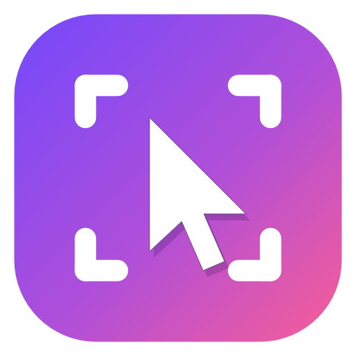
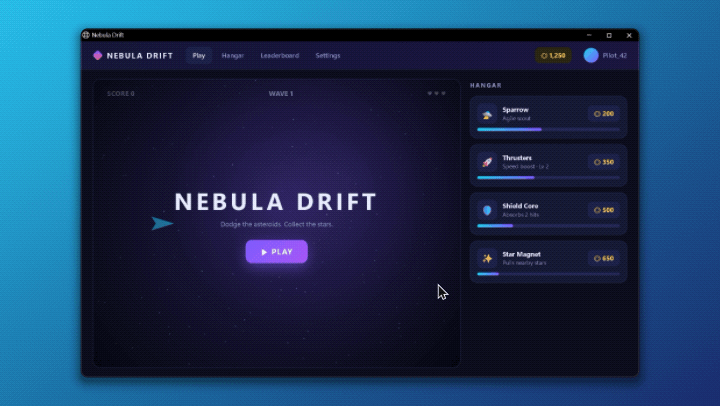
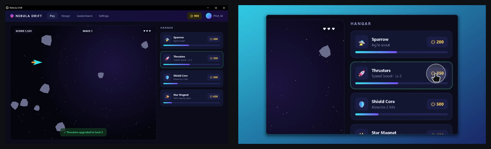
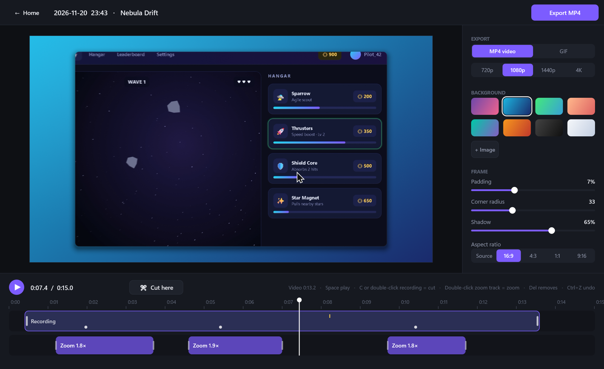
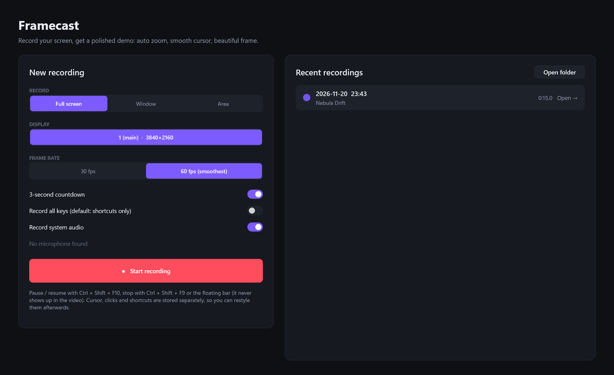
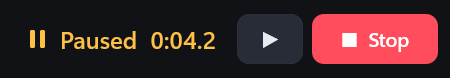

<p align="center">
  
</p>

<h1 align="center">Framecast</h1>

<p align="center">
  밋밋한 화면 녹화를 보기 좋은 제품 소개 영상으로 바꿔 주는, 빠른 Windows 네이티브 화면 녹화기 —<br>
  클릭한 곳 자동 줌, 부드럽고 큼직한 커서, 예쁜 배경. Rust로 작성.
</p>

<p align="center"><a href="README.md">English</a> · <b>한국어</b></p>

<p align="center">
  
  <br><sub>(가짜) 웹게임을 15초 녹화한 뒤 배경만 고르고 바로 내보낸 결과입니다. <a href="docs/media/demo.mp4">MP4 버전</a></sub>
</p>

## 왜 만들었나

웹게임이나 앱을 그냥 화면 녹화하면 밋밋합니다. 커서는 작고, 어디를 봐야 할지 모르겠고, 바탕화면까지 다 보이죠.
Framecast는 화면과 **커서·클릭·단축키를 따로** 기록한 뒤 GPU로 다시 그립니다.
클릭한 곳으로 줌하고, 카메라를 부드럽게 움직이고, 크고 선명한 커서를 다시 그리고, 예쁜 배경 위에 올려 줍니다.
효과는 녹화 후에 입히는 방식이라 언제든 다시 바꿀 수 있습니다.

<p align="center"><br><sub>원본 녹화(왼쪽)와 Framecast로 내보낸 결과(오른쪽)</sub></p>

## 기능

| | |
|---|---|
| **녹화** | 전체 화면, **특정 창**(다른 창에 가려져도 그 창만), 드래그한 **영역** · 30/60fps · 3초 카운트다운 · 시스템 소리 / 마이크 |
| **녹화 컨트롤** | 영상에 절대 찍히지 않는 작은 녹화 바 · **일시정지/재개**(`Ctrl+Shift+F10`) · 정지(`Ctrl+Shift+F9`) |
| **자동 줌** | 클릭 위치로 줌 구간 자동 생성, 줌 중엔 카메라가 커서를 부드럽게 따라감(스프링 + 데드존) |
| **커서** | 원하는 크기로 다시 그리는 벡터 커서(어떤 줌에서도 선명), 움직임 다듬기, 가만히 있으면 숨기기, 클릭 시 눌림 효과 |
| **클릭 효과** | Ripple / Pulse |
| **프레임** | 그라데이션 배경 8종 또는 **내 이미지**(화면 꽉 채우기, 흐림 조절) · 여백 · 둥근 모서리 · 그림자 · 비율(원본/16:9/4:3/1:1/9:16) |
| **단축키 배지** | `Ctrl + C` 같은 단축키를 화면에 표시. 기본값은 단축키만 기록하고 일반 타이핑은 기록하지 않음 |
| **모션 블러** | 빠르게 줌·이동할 때만 은은하게 |
| **편집기** | 소리와 함께 실시간 미리보기, 타임라인(앞뒤 자르기, **중간 구간 잘라내기**, 줌 블록 추가/이동/길이 조절/삭제), 실행취소, 자동 저장 |
| **내보내기** | 하드웨어 H.264 + AAC **MP4**(720p~4K) 또는 **GIF**(480~960px, 10~20fps, 무한 반복), 백그라운드 진행 |

<p align="center"></p>
<p align="center">&nbsp;&nbsp;</p>

### 편집기 조작

| 동작 | 방법 |
|---|---|
| 재생 / 일시정지 | `Space` 또는 미리보기 클릭 |
| 한 프레임 이동 | `←` / `→` |
| 줌 추가 | 줌 트랙 더블클릭 (또는 "Auto-zoom on clicks") |
| 중간 구간 잘라내기 | `C`, 녹화 트랙 더블클릭, 또는 "✂ Cut here" → 빨간 블록의 양 끝을 끌어서 범위 조절 |
| 앞뒤 자르기 | 녹화 트랙 양 끝 손잡이 드래그 |
| 선택한 줌/잘라내기 삭제 | `Delete` |
| 실행취소 / 다시실행 | `Ctrl+Z` / `Ctrl+Y` |

## 성능

개발 PC에서 측정(최적화 빌드):

- **4K 60fps 녹화:** 프레임 누락 0(601/601), 전체 CPU 약 1%, 메모리 약 100MB
- **내보내기:** 4K 원본 10초 → 1080p60 MP4 약 4초

모든 프레임이 GPU에만 머뭅니다: Windows.Graphics.Capture → Direct3D 11 → Media Foundation 하드웨어 인코더,
편집 시에는 하드웨어 디코더 → HLSL 합성 + Direct2D 효과 → 인코더. CPU로 픽셀을 복사하지 않습니다
(GIF만 예외 — 색 수를 줄이는 작업을 CPU에서 해야 해서).

## 빌드

필요: Windows 10 2004 이상(Windows 11 권장), MSVC 툴체인의 Rust.

```bash
cargo build --release --locked
```

결과물: `target/release/framecast.exe` — 설치가 필요 없는 약 0.9MB 단일 실행 파일.

녹화는 `%USERPROFILE%\Videos\Framecast\<날짜_시간>\`에 저장되고
(`raw.mp4`, `events.json`, `project.json`, `system.wav`, `mic.wav`), 내보낸 영상은 `Videos\Framecast\Exports\`에 저장됩니다.

## 의존성 / 보안

외부 의존성은 Microsoft 공식 [`windows`](https://github.com/microsoft/windows-rs) 크레이트 하나뿐이며,
정확한 버전(`=0.62.2`)으로 고정하고 `Cargo.lock`을 커밋해 `--locked`로 빌드합니다. 그 밖의 것(JSON, WAV,
GIF 인코더, UI, 아이콘 삽입)은 모두 이 저장소에서 직접 구현했습니다. 자세한 내용은 [SECURITY.md](SECURITY.md).

어떤 데이터도 PC 밖으로 나가지 않습니다. 네트워크 접근도, 사용 통계 수집도 없습니다.

## 구조

| 파일 | 역할 |
|---|---|
| `src/capture.rs` | Windows.Graphics.Capture: 화면 / 창 / 영역, 창 목록 |
| `src/selector.rs` | 창·영역 선택 화면 |
| `src/media.rs` | Media Foundation 하드웨어 인코더/디코더 (GPU 텍스처 입출력) |
| `src/audio.rs` | WASAPI 시스템 소리·마이크 녹음, 믹싱, 미리듣기 |
| `src/input.rs` | 마우스/키보드 훅, 커서 모양, 단축키 |
| `src/clock.rs` | 일시정지를 반영하는 녹화 시계 (영상·입력·소리 공용) |
| `src/recorder.rs` | 녹화 스레드 (고정 fps + 이벤트 기록) |
| `src/project.rs` | 프로젝트 데이터, 자동 줌, 스프링 기반 카메라/커서 움직임, 편집 타임라인 |
| `src/render.rs` | 합성: HLSL(배경, 그림자, 둥근 프레임, 줌, 모션 블러) + Direct2D(커서, 클릭, 배지) |
| `src/export.rs`, `src/gif.rs` | 내보내기 스레드, 자체 GIF 인코더 |
| `src/ui.rs`, `src/window.rs`, `src/app.rs` | Direct2D 기반 자체 UI (홈, 녹화 바, 편집기) |
| `src/image.rs` | 이미지 불러오기(WIC), 파일 선택 창 |
| `src/icon.rs`, `build.rs` | Direct2D로 그린 앱 아이콘, 빌드 의존성 없이 exe에 삽입 |
| `docs/demo/nebula-drift.html` | 데모 영상 녹화에 쓴 가짜 게임 화면 |

### 개발용 옵션

`--record <초>` · `--record-window <창 제목> <초>` · `--export <프로젝트 폴더>` · `--open <프로젝트 폴더>` · `--make-icon <out.ico>`
· 환경변수 `FRAMECAST_SHOW_CONTROLS_IN_CAPTURE=1`(녹화 바가 캡처에 보이게) · 로그: `Videos\Framecast\framecast.log`

## 다음 계획

- 웹캠 오버레이

## 라이선스

[MIT](LICENSE). Framecast는 Screen Studio, FocuSee 같은 도구에서 영감을 받은 독립 프로젝트이며, 해당 제품들과 관련이 없습니다.
