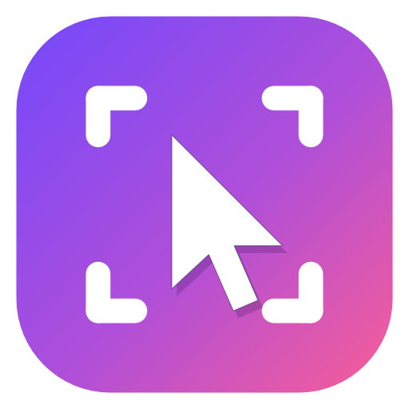
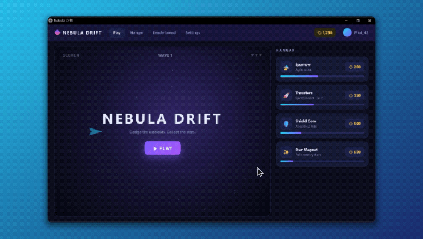
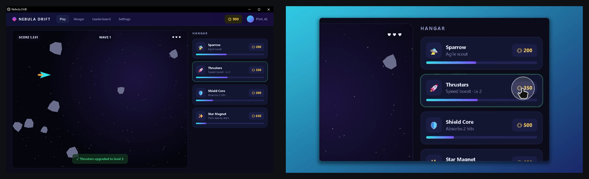
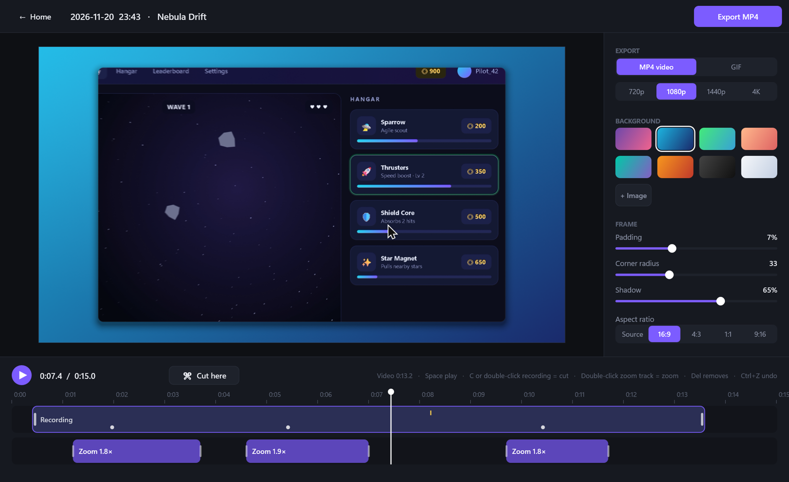
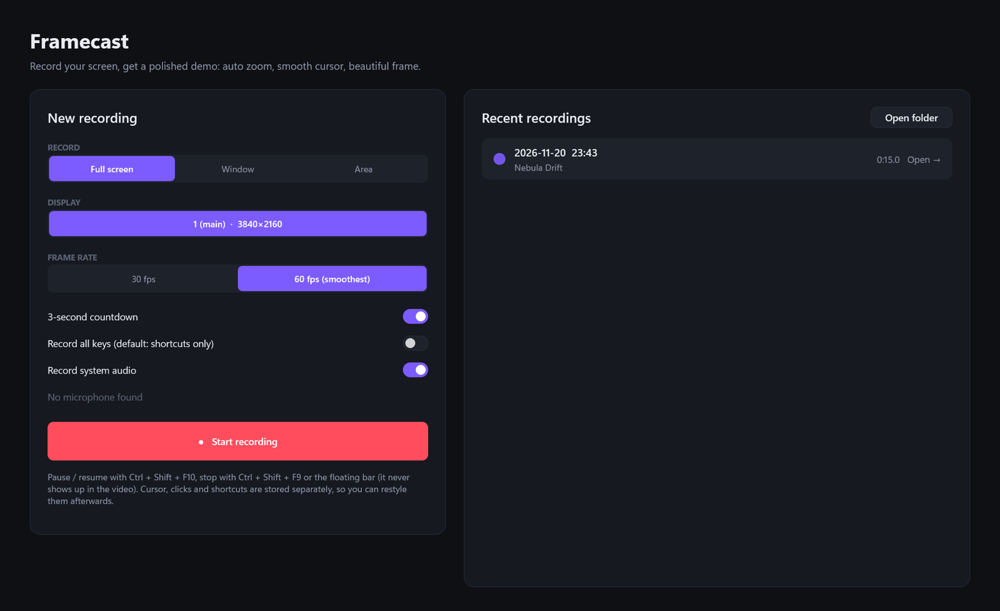
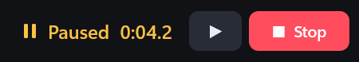

<p align="center">
  
</p>

<h1 align="center">Framecast</h1>

<p align="center">
  A fast, native Windows screen recorder that turns plain captures into polished product demos —<br>
  auto zoom on clicks, a smooth oversized cursor, beautiful backgrounds. Written in Rust.
</p>

<p align="center"><b>English</b> · <a href="README.ko.md">한국어</a></p>

<p align="center">
  
  <br><sub>Made with Framecast from a 15-second recording of a (fake) web game — no manual editing besides picking a background. <a href="docs/media/demo.mp4">MP4 version</a></sub>
</p>

## Why

A raw screen recording of your web game or app looks flat: tiny cursor, no focus, the whole desktop in view.
Framecast records the screen **and** your cursor, clicks and shortcuts separately, then re-renders them on the GPU:
it zooms where you click, glides the camera, redraws a big crisp cursor, and frames everything on a nice background.
Because the effects are applied after recording, you can change all of them later.

<p align="center"><br><sub>Raw capture (left) vs. Framecast export (right)</sub></p>

## Features

| | |
|---|---|
| **Record** | Full screen, a single **window** (even when covered by other windows), just the **web page** of a browser window (no tabs, address bar or bookmarks bar; follows resizes), or a dragged **area** · 30/60 fps · 3-second countdown · system audio and microphone |
| **Controls** | Floating bar that never appears in the video · **Pause / resume** (`Ctrl+Shift+F10`) · Stop (`Ctrl+Shift+F9`) |
| **Auto zoom** | Zoom segments generated from your clicks; the camera follows the cursor with a spring + dead zone |
| **Cursor** | Vector cursor redrawn at any size (sharp at any zoom), motion smoothing, hide when idle, press animation |
| **Click effects** | Ripple or pulse |
| **Frame** | 8 gradient backgrounds or **your own image** (cover-fit, adjustable blur) · padding · rounded corners · shadow · aspect ratio (source / 16:9 / 4:3 / 1:1 / 9:16) |
| **Shortcut badges** | Shows shortcuts like `Ctrl + C` on screen. Only shortcuts are logged by default — never plain typing |
| **Motion blur** | Subtle, only during fast zooms/pans |
| **Editor** | Live preview with audio, timeline with trim, **cut out sections**, zoom blocks (add / move / resize / delete), undo/redo, autosave |
| **Export** | Hardware H.264 + AAC **MP4** (720p–4K) or **GIF** (480–960 px, 10–20 fps, loops) in the background |

<p align="center"></p>
<p align="center">&nbsp;&nbsp;</p>

### Editor controls

| Action | How |
|---|---|
| Play / pause | `Space` or click the preview |
| Step one frame | `←` / `→` |
| Add a zoom | Double-click the zoom track (or "Auto-zoom on clicks") |
| Cut out a section | `C`, double-click the recording track, or "✂ Cut here" — then drag the red block's edges |
| Trim start/end | Drag the handles at the ends of the recording track |
| Delete selected zoom/cut | `Delete` |
| Undo / redo | `Ctrl+Z` / `Ctrl+Y` |

## Performance

Measured on the development PC (release build):

- **4K 60 fps recording:** 0 dropped frames (601/601), ~1% total CPU, ~100 MB RAM
- **Export:** 10 s of 4K source → 1080p60 MP4 in ~4 s

Every frame stays on the GPU: Windows.Graphics.Capture → Direct3D 11 → Media Foundation hardware encoder,
and back through the hardware decoder → HLSL compositor + Direct2D overlays → encoder. No CPU pixel copies
(except for GIF, which has to be quantized on the CPU).

## Build

Requirements: Windows 10 2004+ (Windows 11 recommended) and Rust with the MSVC toolchain.

```bash
cargo build --release --locked
```

Output: `target/release/framecast.exe` — a single ~0.9 MB executable, nothing to install.

Recordings are stored in `%USERPROFILE%\Videos\Framecast\<date_time>\`
(`raw.mp4`, `events.json`, `project.json`, `system.wav`, `mic.wav`); exports go to `Videos\Framecast\Exports\`.

## Dependencies & security

The only dependency is Microsoft's official [`windows`](https://github.com/microsoft/windows-rs) crate, pinned to an
exact version (`=0.62.2`) with `Cargo.lock` committed; builds use `--locked`. Everything else — JSON, WAV, the GIF
encoder, the UI toolkit, the icon/resource embedding — is implemented in this repository. See [SECURITY.md](SECURITY.md).

Nothing ever leaves your machine: no network access, no telemetry.

## Project layout

| File | Purpose |
|---|---|
| `src/capture.rs` | Windows.Graphics.Capture: display / window / cropped area, window list |
| `src/browser.rs` | Finds and tracks a browser's page viewport (Chromium render widget, UI Automation fallback) |
| `src/selector.rs` | Full-screen picker for windows and areas |
| `src/media.rs` | Media Foundation hardware encoder / decoder (GPU textures in and out) |
| `src/audio.rs` | WASAPI loopback + mic capture, mixing, preview playback |
| `src/input.rs` | Low-level mouse/keyboard hooks, cursor shapes, hotkeys |
| `src/clock.rs` | Pause-aware recording clock shared by video, input and audio |
| `src/recorder.rs` | Recording thread (fixed-rate sampling + event log) |
| `src/project.rs` | Project data, auto zoom, spring-based camera/cursor motion, edit timeline |
| `src/render.rs` | Compositor: HLSL (background, shadow, rounded frame, zoom, motion blur) + Direct2D (cursor, clicks, badges) |
| `src/export.rs`, `src/gif.rs` | Export threads; in-house GIF encoder (changed-rect frames, per-frame palettes, LZW) |
| `src/ui.rs`, `src/window.rs`, `src/app.rs` | Immediate-mode Direct2D UI (home, recording bar, editor) |
| `src/image.rs` | Image loading (WIC) and the file dialog |
| `src/icon.rs`, `build.rs` | App icon drawn with Direct2D, embedded without build dependencies |
| `docs/demo/nebula-drift.html` | The fake game used to record the demo media |

### Developer flags

`--record <secs>` · `--record-window <title> <secs>` · `--record-browser <title> <secs>` · `--export <project dir>` · `--open <project dir>` · `--make-icon <out.ico>`
· env `FRAMECAST_SHOW_CONTROLS_IN_CAPTURE=1` (lets screenshots include the recording bar) · log at `Videos\Framecast\framecast.log`

## Roadmap

- Webcam overlay

## License

[MIT](LICENSE). Framecast is an independent project, inspired by tools like Screen Studio and FocuSee, and not affiliated with them.
